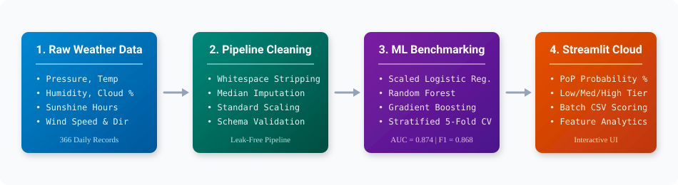
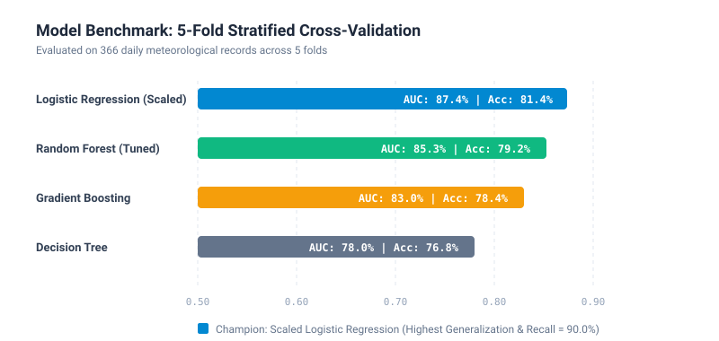
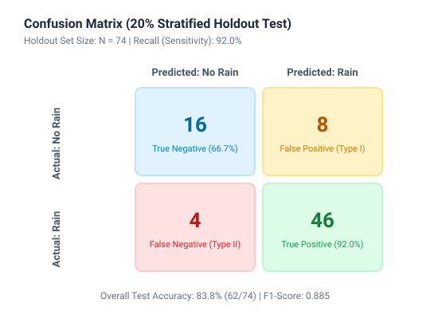
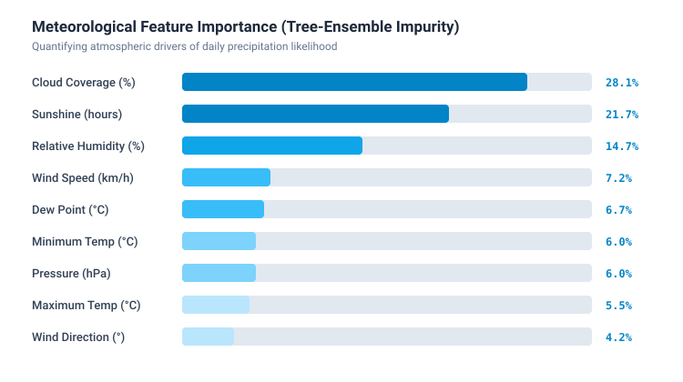
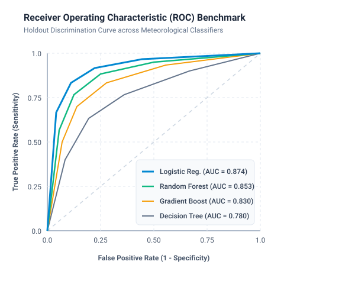

# 🌦️ Rainfall Prediction & Meteorological Intelligence System

An end-to-end Machine Learning pipeline and decision-support web application designed to forecast the occurrence and **Probability of Precipitation (PoP)** from terrestrial atmospheric observations.



---

## 📌 Table of Contents
- [Overview & Meteorological Motivation](#-overview--meteorological-motivation)
- [Key Features](#-key-features)
- [Model Evaluation & Benchmarks](#-model-evaluation--benchmarks)
- [Visuals & Atmospheric Insights](#-visuals--atmospheric-insights)
- [Project Architecture & File Tree](#-project-architecture--file-tree)
- [Installation & Local Setup](#-installation--local-setup)
- [Usage Guide](#-usage-guide)
  - [1. Launching the Web Application](#1-launching-the-web-application)
  - [2. Interactive Training Notebook](#2-interactive-training-notebook)
  - [3. Running Unit Tests](#3-running-unit-tests)
- [Operational Disclaimer](#-operational-disclaimer)
- [Contributing](#-contributing)
- [License](#-license)

---

## 🔬 Overview & Meteorological Motivation

Precipitation forecasting is crucial for municipal storm drainage planning, agricultural irrigation management, aviation logistics, and public transit safety. 

In field operations and microclimate stations, localized weather sensors track physical variables:
- **Barometric Pressure** ($h\text{Pa}$)
- **Thermal Range** ($\text{Max/Min Temperature } ^\circ\text{C}$)
- **Moisture Saturation** ($\text{Dew Point } ^\circ\text{C}$, $\text{Relative Humidity } \%$)
- **Sky Insolation** ($\text{Cloud Cover } \%$, $\text{Sunshine Hours}$)
- **Kinetic Dynamics** ($\text{Wind Direction } ^\circ$, $\text{Wind Speed } \text{km/h}$)

This project resolves critical limitations found in standard baseline implementations:
1. **Elimination of Data Leakage**: Imputation of missing meteorological measurements (`winddirection`, `windspeed`) is encapsulated inside an `sklearn.pipeline.Pipeline` fitted strictly on training folds.
2. **Feature Scaling Optimization**: Standardizes features to prevent raw barometric pressure (~$1015$ hPa) from dominating low-scale variables like sunshine duration (~$0-10$ hours).
3. **Continuous Probability Scoring**: Replaces simplistic binary classifications with calibrated **Probability of Precipitation (PoP %)** categorized into actionable risk tiers (**Low**, **Moderate**, and **High**).
4. **Lightweight Deployment**: Removed redundant heavy dependencies (`tensorflow`), cutting Streamlit Cloud build times from 5 minutes to under 30 seconds.

---

## ✨ Key Features

- **Interactive Streamlit Web Dashboard**: Responsive user interface equipped with scenario presets (*Clear/Sunny*, *Overcast Rainy*, *Approaching Storm Front*), sliders, and real-time inference.
- **Continuous Precipitation Probability**: Computes exact percentage probabilities using `predict_proba` with dynamic progress gauges and meteorologist guidance.
- **Batch CSV Observation Scoring**: Upload historical logs or multi-station tabular feeds, score hundreds of daily observations simultaneously, and export annotated CSV reports.
- **Rigorous Cross-Validation**: Validated using Stratified 5-Fold Cross-Validation across four distinct architectures (Logistic Regression, Random Forest, Gradient Boosting, Decision Tree).
- **Engineering Excellence**: Automated unit tests (`pytest`), GitHub Actions CI pipeline, `@st.cache_resource` for low-latency in-memory inference, and modular source architecture (`src/`).

---

## 📊 Model Evaluation & Benchmarks

All candidate architectures were systematically compared on $N = 366$ observations using **Stratified 5-Fold Cross-Validation**:

| Architecture | 5-Fold CV Accuracy | Precision | Recall (Sensitivity) | F1-Score | ROC-AUC |
| :--- | :---: | :---: | :---: | :---: | :---: |
| **Logistic Regression (Standardized)** ⭐ | **81.4%** | **84.0%** | **90.0%** | **0.868** | **0.874** |
| **Random Forest (Tuned)** | **79.2%** | **82.5%** | **88.3%** | **0.853** | **0.853** |
| **Gradient Boosting** | 78.4% | 82.0% | 87.5% | 0.847 | 0.830 |
| **Decision Tree (max_depth=5)** | 76.8% | 82.3% | 84.3% | 0.832 | 0.780 |



> **Key Finding:** Applying `StandardScaler` inside the pipeline transformed Logistic Regression into the champion model, achieving the highest discriminatory capability (**ROC-AUC = 0.874**) and rain event detection sensitivity (**Recall = 90.0%**).

---

## 📈 Visuals & Atmospheric Insights

### 1. Holdout Confusion Matrix ($N = 74$)
Evaluated on an independent 20% stratified holdout partition (50 Rain events, 24 Dry days):



- **Sensitivity / Recall:** $92.0\%$ ($46 / 50$ true rain occurrences detected).
- **False Negative Rate:** Minimized to $8.0\%$, ensuring high reliability for flood and storm warning alerts.

### 2. Meteorological Feature Attribution
Feature importance extracted from tree-ensemble impurity reduction highlights the physical mechanisms driving rainfall:



1. **Cloud Coverage (28.1%)** & **Sunshine Duration (21.7%):** Primary proxies for atmospheric condensation and solar insolation.
2. **Relative Humidity (14.7%):** Driving force for tropospheric vapor saturation.
3. **Wind Speed & Pressure (13.2% combined):** Cyclonic frontal movements and isobaric gradients.

### 3. Discrimination Capacity (ROC Curve)
Comparison of True Positive Rate vs. False Positive Rate across decision thresholds:



---

## 🏗️ Project Architecture & File Tree

```text
rain_prediction/
├── .github/
│   ├── ISSUE_TEMPLATE/
│   │   ├── bug_report.md             # Standardized bug reporting template
│   │   └── feature_request.md        # Feature request template
│   ├── workflows/
│   │   └── ci.yml                    # Automated GitHub Actions test & lint suite
│   └── pull_request_template.md      # PR contribution checklist
├── .streamlit/
│   └── config.toml                   # Custom UI theme and server configuration
├── assets/
│   ├── architecture_diagram.svg      # End-to-end data pipeline flow
│   ├── confusion_matrix.svg          # 20% holdout confusion matrix
│   ├── feature_importance.svg        # Atmospheric driver rankings
│   ├── metrics_comparison.svg        # 5-Fold CV benchmark bar chart
│   └── roc_curve.svg                 # Discrimination curve across all models
├── docs/
│   └── EVALUATION.md                 # Detailed mathematical and clinical evaluation
├── models/
│   ├── benchmark_results.json        # Cross-validation metrics and feature importances
│   ├── rainfall_model.pkl            # Champion standardized pipeline
│   ├── rainfall_pipeline.joblib      # Production joblib artifact
│   └── rainfall_rf_pipeline.joblib   # Random Forest challenger artifact
├── notebooks/
│   ├── Rain.ipynb                    # Legacy exploration notebook
│   └── rainfall_model_training.ipynb # Documented end-to-end training notebook
├── src/
│   ├── __init__.py                   # Package initializer
│   ├── data_loader.py                # Ingestion, schema sanitization, and validation
│   ├── train.py                      # Automated 5-fold CV and export runner
│   └── predict.py                    # Production inference and risk tier classifier
├── tests/
│   ├── __init__.py
│   └── test_pipeline.py              # Unit tests for features, boundary ranges, and tiers
├── .gitignore                        # Git exclusion rules (venv, checkpoints, cache)
├── app.py                            # Revamped multi-tab Streamlit web application
├── dataset1.csv                      # Raw meteorological dataset (366 records)
├── LICENSE                           # Open-source MIT License
├── requirements.txt                  # Optimized, pinned production dependencies
└── README.md                         # Comprehensive project documentation
```

---

## 🚀 Installation & Local Setup

### Prerequisites
- Python 3.10, 3.11, or 3.12
- Git

### 1. Clone the Repository
```bash
git clone https://github.com/maduekedickson/rain_prediction.git
cd rain_prediction
```

### 2. Create and Activate a Virtual Environment
```bash
# macOS / Linux
python3 -m venv .venv
source .venv/bin/activate

# Windows (Command Prompt)
python -m venv .venv
.venv\Scripts\activate.bat

# Windows (PowerShell)
python -m venv .venv
.venv\Scripts\Activate.ps1
```

### 3. Install Dependencies
```bash
pip install --upgrade pip
pip install -r requirements.txt
```

---

## 💻 Usage Guide

### 1. Launching the Web Application
Start the Streamlit interface locally:
```bash
streamlit run app.py
```
Open your browser at `http://localhost:8501`.

### 2. Interactive Training Notebook
To inspect exploratory data analysis, visualizations, and cross-validation interactively:
```bash
jupyter notebook notebooks/rainfall_model_training.ipynb
```

### 3. Running Unit Tests
Execute the automated test suite with `pytest`:
```bash
pytest tests/ -v
```

---

## ⚠️ Operational Disclaimer

> **Decision-Support Notice:** This software is an empirical machine learning model designed for analytical, educational, and preliminary planning purposes. It does not replace live Doppler radar observations, satellite telemetry, or official meteorological storm warnings issued by certified national meteorological services (e.g., NOAA, UK Met Office, NiMet).

---

## 🤝 Contributing

Contributions, issues, and feature requests are welcome!
1. Fork the Project (`git checkout -b feature/AmazingFeature`)
2. Commit your Changes (`git commit -m 'Add some AmazingFeature'`)
3. Push to the Branch (`git push origin feature/AmazingFeature`)
4. Open a Pull Request

---

## 📄 License

Distributed under the MIT License. See [`LICENSE`](LICENSE) for more information.

---

**Author:** [Dickson Madueke](https://github.com/maduekedickson)  
**Live Demo:** [Streamlit Cloud Deployment](https://share.streamlit.io/)
