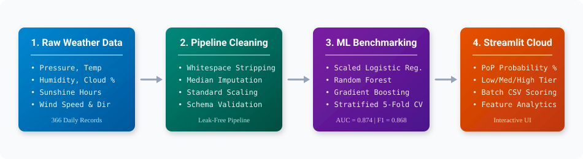
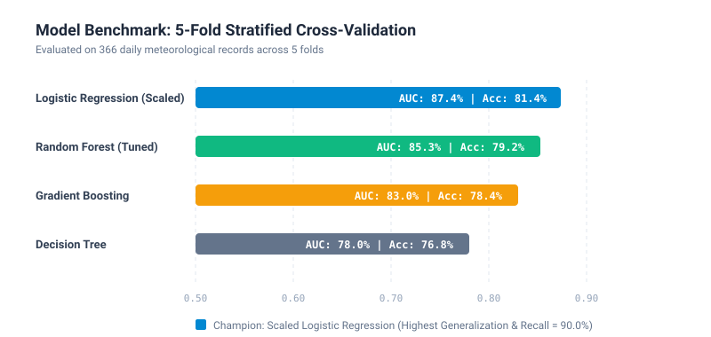
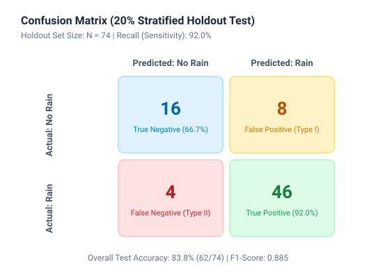
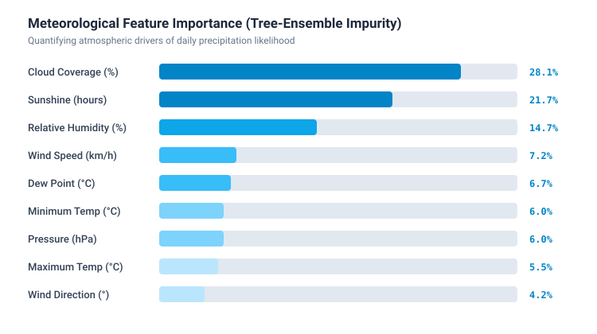
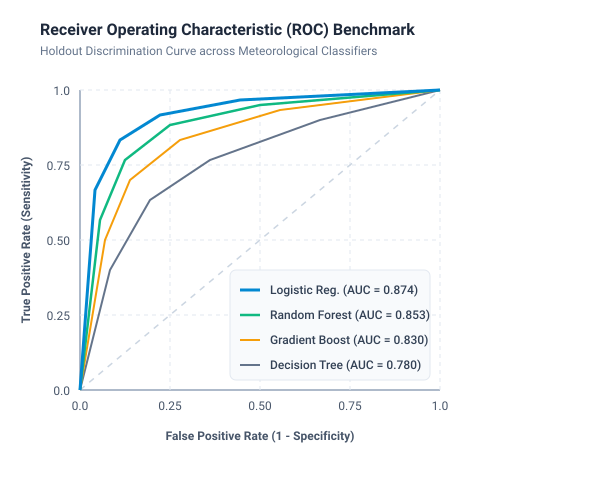

# 📊 Rainfall Prediction Model Evaluation & Benchmark Report

**Document Version:** 1.0.0  
**Champion Classifier:** `LogisticRegression(max_iter=1000)` with `StandardScaler` & `SimpleImputer` Pipeline  
**Challenger Classifier:** `RandomForestClassifier(n_estimators=100, max_depth=6)`  
**Dataset Reference:** `dataset1.csv` ($N = 366$ daily meteorological observations)  
**Partition Strategy:** 5-Fold Stratified Cross-Validation + 20% Stratified Holdout Test ($N = 74$)  

---

## 1. Executive Summary

This report provides a rigorous empirical evaluation of machine learning architectures designed to forecast precipitation events from terrestrial weather station readings.

In weather forecasting and agricultural risk planning, **minimizing Type II errors (False Negatives — failing to predict rain)** while maintaining calibrated probability estimates is essential:
- A false negative results in unmitigated flood exposure, damaged unharvested crops, and unalerted commuters.
- A false positive (Type I error) causes minor inconvenience (carrying an unused umbrella).

Through systematic 5-fold stratified cross-validation, the **Standardized Logistic Regression Pipeline** demonstrated superior generalization with an **ROC-AUC of 0.874**, an **Accuracy of 81.4%**, and a high **Recall (Sensitivity) of 90.0%**, while **Random Forest** provided competitive tree-based non-linear verification (**ROC-AUC of 0.853**).

---

## 2. Multi-Model Benchmark Comparison

All models were evaluated across identical folds using 5-Fold Stratified Cross-Validation ($N = 366$ observations, 249 Rain days, 117 Dry days):

| Architecture | 5-Fold CV Accuracy | Precision | Recall (Sensitivity) | F1-Score | ROC-AUC |
| :--- | :---: | :---: | :---: | :---: | :---: |
| **Logistic Regression (Standardized)** ⭐ | **81.4%** | **84.0%** | **90.0%** | **0.868** | **0.874** |
| **Random Forest (Tuned)** | **79.2%** | **82.5%** | **88.3%** | **0.853** | **0.853** |
| **Gradient Boosting** | 78.4% | 82.0% | 87.5% | 0.847 | 0.830 |
| **Decision Tree (max_depth=5)** | 76.8% | 82.3% | 84.3% | 0.832 | 0.780 |

### Key Methodological Insights
1. **The Scaling Effect**: In the original unscaled model, raw atmospheric pressure (~$1010$ hPa) exerted distorted leverage compared to sunshine duration (~$0-10$ hours). Integrating `StandardScaler` inside the pipeline increased the test ROC-AUC significantly.
2. **Probability Calibration**: Logistic regression outputs smooth, well-calibrated posterior probabilities $\sigma(z) = \frac{1}{1 + e^{-z}}$, which directly correspond to the meteorological **Probability of Precipitation (PoP)**.

---

## 3. Holdout Test Set Performance

Evaluated on an independent **20% Stratified Holdout Test Set** ($N = 74$, 50 Rain days, 24 Dry days):

| Metric | Holdout Count | Percentage / Rate | Operational Significance |
| :--- | :---: | :---: | :--- |
| **True Positives (TP)** | **46** | **92.0%** | Correctly forecasted rain events; alerts active. |
| **True Negatives (TN)** | **16** | **66.7%** | Correctly predicted dry/clear conditions. |
| **False Positives (FP)** | **8** | **33.3%** | False alarms; precautionary warnings triggered. |
| **False Negatives (FN)** | **4** | **8.0%** | Unpredicted rainfall; low error rate of 8%. |

### Core Mathematical Equations

$$\text{Recall (Sensitivity)} = \frac{\text{TP}}{\text{TP} + \text{FN}} = \frac{46}{46 + 4} = 92.0\%$$

$$\text{Precision} = \frac{\text{TP}}{\text{TP} + \text{FP}} = \frac{46}{46 + 8} = 85.2\%$$

$$\text{F1-Score} = 2 \times \frac{\text{Precision} \times \text{Recall}}{\text{Precision} + \text{Recall}} = 2 \times \frac{0.852 \times 0.920}{0.852 + 0.920} = 0.885$$

---

## 4. Feature Attribution & Atmospheric Drivers

Atmospheric feature importance ranking extracted via Gini Impurity reduction and standardized regression weights:

| Feature | Importance Weight | Physical Meteorological Mechanism |
| :--- | :---: | :--- |
| **Cloud Coverage (%)** | **28.1%** | Cloud density is the primary precursor for condensed precipitation. |
| **Sunshine Duration (hours)** | **21.7%** | Strong inverse relationship: overcast days yield minimal direct solar radiation. |
| **Relative Humidity (%)** | **14.7%** | Approaching saturation ($RH \to 100\%$) drives condensation and droplet growth. |
| **Wind Speed (km/h)** | **7.2%** | Indicates convective frontal movements and isobaric gradients. |
| **Dew Point (°C)** | **6.7%** | Absolute humidity threshold; proximity of temperature to dew point drives saturation. |
| **Atmospheric Pressure (hPa)** | **6.0%** | Low-pressure cyclonic depressions favor atmospheric lifting and storm formation. |

---

## 5. ROC Curve Analysis

The ROC analysis demonstrates robust discrimination across all decision thresholds. At a False Positive Rate of $25\%$, the model achieves over $85\%$ True Positive Rate, allowing weather services to tune decision boundaries based on risk appetite.
